# `agy-dart` — AI 审阅技术简报（AI Review Brief）

<!-- AUTO:INTRO:START -->
> **本文档用途**：面向代码审阅 AI / 架构审计 AI / 安全审查 AI 的高密度项目总览与审阅路线图。对应当前版本 `v1.10.4`。代码行数、模块映射与测试数量由 `scripts/gen-review-brief.mjs` 自动同步并受 `--check` 漂移守卫保护。
<!-- AUTO:INTRO:END -->

<!-- AUTO:META:START -->
> **同步快照（由 `scripts/gen-review-brief.mjs` 自动维护）**：版本 `v1.10.4` · 核心追踪文件 72 个（合计 91,751 行） · 测试套件 63 个 / 428 个用例 · 可运行 `node scripts/gen-review-brief.mjs --check` 检验零漂移。
<!-- AUTO:META:END -->

---

## 1. 项目一句话定位、硬不变量与威胁模型

**`agy-dart`** 是面向 **Google Antigravity**（Desktop 2.0 / IDE / CLI）的原生一体化插件，将 **极速批处理加速引擎 (`agy-dart_fast`)**、**沙盒过滤与 SQLite FTS5 上下文护栏 (`agy-dart_context`)**、**5 个生命周期 Hooks**、**服务端 Prompt Cache / KV-Cache 诊断与回放体系** 以及 **内置 Stall Watchdog 的 Aux Pane 实时 Sidecar 仪表盘** 融合成单一零依赖插件。

### 1.1 审阅时必须核验的 8 条硬不变量

| # | 硬不变量 | 验证位置 |
| :-: | :--- | :--- |
| 1 | **零运行期 npm 依赖**：仅使用 Node.js `>= 22` 内置模块（`node:sqlite`、`node:zlib`、`node:crypto`、`node:module` 等），`package.json` 无 `dependencies` | `package.json` |
| 2 | **严格 MIT 净室合规**：严禁引入 ELv2 / BUSL-1.1 / AGPL-3.0 / Apache-2.0 源码，所有借鉴模式须为净室实现并登记于声明文件 | `THIRD_PARTY_NOTICES.md`、`LICENSE` |
| 3 | **MCP 单次响应严格 `<= 8.8 KB` UTF-8**：基于实测 Antigravity MCP 工具返回约 `10 KB` 即触发落盘 `output.txt` 造成二次读取，扣除 JSON-RPC 封装与转义开销后留取 `8.8 KB`（`8,800` / `8,100` B）安全内联上限；截断不得劈裂 UTF-8 多字节（尤其 CJK/Emoji） | `fast/mcp-server.mjs`、`context/lib/tools.js`、`hooks/filter-rules.mjs` |
| 4 | **JSON-RPC stdio 零污染（0 字节 stderr）**：双 MCP 服务与 5 个生命周期钩子（含 V8 编译缓存激活、SQLite `ExperimentalWarning` 拦截及异常 fail-open）在 Node 22.x / 24.x 下均不得向 `stdout`/`stderr` 输出任何杂音 | `fast/mcp-server.mjs`、`context/server.js`、`hooks/compile-cache.mjs`、`hooks/stop.mjs` |
| 5 | **Turn-0 前缀确定性与预算封顶**：双 MCP `tools/list` 按键名与工具名规范排序（`canonical = true`）、两次握手 SHA-256 一致；常驻 Turn-0 总估算 `<= 4,000` tokens（含跨语种校准 `±15%` 误差上界） | `scripts/prefix-budget.mjs`、`scripts/cache-audit.mjs`、`context/lib/stable-json.js` |
| 6 | **中段 Hook 零前缀污染**：`PreInvocation` 告警必须输出 `systemMessage: ""` + `metadata.user_markdown`，`Stop` 仅输出 `{"decision":"allow"}`（不带 `reason`），严禁向模型注入动态文本破坏服务端 KV-Cache | `hooks/pre-invocation.mjs`、`hooks/stop.mjs` |
| 7 | **钩子严格 Fail-Open 与 0-SQLite 快路径**：任何 Hook 遇到 DB 锁/权限/异常都必须放行；`read_file` 对 `SKILL.md`/`AGENTS.md`/附件/二进制及未受管工具不得打开或创建 SQLite DB，空闲时 Watchdog 零 `statSync`，并受 p50/p95 延迟预算约束 | `hooks/pre-tool-use.mjs`、`hooks/post-tool-use.mjs`、`hooks/session-start.mjs`、`hooks/stop.mjs`、`context/lib/watchdog.js` |
| 8 | **端到端安全边界**：`ctx_index(url)` 强制 SSRF 逐跳 DNS（含 IPv4 映射 IPv6）与 IP Pinning；CLI 过滤严禁放行未授权 Shell 注入或 cmd/PS 跨 Shell 语义漂移元字符；`.agy-dart/filters.json` 拒收指数/分组多项式 ReDoS 正则；Sidecar 强制 `Host`/`Origin`/`Sec-Fetch-Site`（含 `same-site`）防 DNS Rebinding 与跨端口 CSRF、全部独立 HTTP `/api/*`（GET/POST）强制随机 `X-Agy-Dart-Token`、`SidecarApp` 模式全部 `/api/*` 路由仅限 `POST`（强制 `X-Sidecar-Token`）、写接口与 `/api/search` 及 `/api/watchdog/action` 仅 `POST` + `application/json` + `64 KB` 请求体上限，桌面提醒仅通过 env/argv 传参且默认关闭，前端防 XSS | `context/lib/security.js`、`context/lib/watchdog.js`、`hooks/filter-rules.mjs`、`sidecars/dashboard/{server.mjs,index.html}` |

### 1.2 威胁模型（Threat Model）

| 主体 / 输入来源 | 信任级别 | 假设威胁与防护策略 |
| :--- | :---: | :--- |
| **本地用户与 `~/.agy-dart/config.json`** | 可信 | 拥有本机权限与配置控制权；配置解析仍采用 fail-open，畸形 JSON 不会导致 Hook 崩溃 |
| **LLM 模型生成的工具参数** | 半可信（可能幻觉/受间接提示注入） | `ctx_index(url)` 强制 SSRF 与私网/回环/元数据拦截；`run_command` 仅对白名单单条安全命令透明改写，拒绝管道/重定向/子 Shell/cmd&PS 元字符；`diffRead` 默认关闭并严格绑定直接对话 ID 与新鲜度窗口 |
| **工作区仓库内的 `.agy-dart/filters.json`** | 不可信（可能来自第三方恶意仓库） | 所有自定义正则先过零依赖 `isSafeRegex` ReDoS 检测（拒收嵌套量词、分组/非相邻可重叠循环、歧义分支、反向引用与超大重复界），非法规则静默降级跳过 |
| **本机任意浏览器标签页 / 恶意网页** | 不可信 | 攻击者可能通过 ``、同机跨端口请求（`Sec-Fetch-Site: same-site`）、CORS 简单 POST 或 DNS Rebinding 访问 Sidecar。防护：写操作与 `/api/search` 禁止 GET、校验 `Host` 仅限 loopback、拦截 `cross-site` 与 `/api/*` 上的 `same-site`、全部独立 HTTP `/api/*` 请求强制随机 `X-Agy-Dart-Token`、写接口强制 `Content-Type: application/json` 与 `64 KB` 请求体封顶；SidecarApp 模式对全部 `/api/*` 路由（含只读与写接口）均强制仅限 POST（禁止 GET），以确保 `sidecar_sdk` 强制校验 `X-Sidecar-Token` |
| **远端 HTTP(S) 响应与本地大文件/日志** | 不可信（可能含密钥、恶意重定向或超长多字节载荷） | `fetchUrlText` 限制协议/重定向次数/总字节与超时并做 DNS Pinning；入库与回传前执行 `redactSecrets`；输出经 UTF-8 安全截断不产生 `\uFFFD` 或孤立代理项 |

### 1.3 硬不变量 → 测试用例对照表

| 不变量 | 关键覆盖测试文件与用例名称 |
| :-: | :--- |
| #1 零运行期 npm 依赖 | `package.json`（无 `dependencies`）+ `tests/v1.2-hardening.test.mjs` (`P1-Hardening 3: Static import-graph verification...`) |
| #2 MIT 净室合规 | `THIRD_PARTY_NOTICES.md`、`LICENSE`（人工与发版审阅清单） |
| #3 `<= 8.8 KB` UTF-8 无损截断 | `tests/v1.2-property-fuzz.test.mjs` (`Property 1: UTF-8 truncation helpers...`), `tests/v1.2-cli-crusher.test.mjs`, `tests/v1.1-roi-optimizations.test.mjs` (`Opt 5`, `Hardening regressions`) |
| #4 stdio 零污染（0B stderr） | `tests/v1.2-hardening.test.mjs` (`P1-Hardening 5: Exact 0-byte stderr...`), `tests/v1.2-quickfixes.test.mjs` (`Fix 2`), `tests/v1.2-persist-prefix.test.mjs` (`P1-8B`) |
| #5 Turn-0 确定性与预算校准 | `tests/v1.2-hardening.test.mjs` (`P1-Hardening 7: Token estimator empirical calibration...`), `tests/v1.2-cache-audit.test.mjs` (`1.`, `2.`), `tests/v1.2-persist-prefix.test.mjs` (`P1-5C`), `tests/v1.2-quickfixes.test.mjs` (`Fix 4`) |
| #6 中段 Hook 零前缀污染 | `tests/v1.2-ttl-handoff.test.mjs` (`P1-7.4`), `tests/v1.1-features.test.mjs` (`P0 PreInvocation hook...`), `tests/v1.2-cache-model.test.mjs` (`P0-2.6`) |
| #7 Fail-Open、0-SQLite 与延迟预算 | `tests/v1.2-hardening.test.mjs` (`P1-Hardening 6: Hook latency budgets...`), `tests/integration.test.mjs`, `tests/v1.1-tianshu-cache.test.mjs` |
| #8 SSRF / Shell / ReDoS / Sidecar CSRF & XSS | `tests/v1.2-hardening.test.mjs` (`P0-Hardening 1: Sidecar CSRF...`), `tests/v1.2-property-fuzz.test.mjs` (`Property 2`, `Property 3`, `Property 5`), `tests/v1.1-roi-optimizations.test.mjs` (`Opt 2`, `Hardening regressions`), `tests/v1.2-context-breakdown.test.mjs` (`P2-9.4`) |

---

## 2. 架构与控制流总览

```mermaid
flowchart TB
    subgraph Lifecycle["Antigravity 5 大生命周期 Hooks (hooks.json)"]
        SS["SessionStart<br/>hooks/session-start.mjs"]
        PTU["PreToolUse (read_file|view_file|run_command)<br/>hooks/pre-tool-use.mjs"]
        PSTU["PostToolUse (run_command/edit/write/apply_edits/run_checks/ctx_resume/call_mcp_tool)<br/>hooks/post-tool-use.mjs"]
        PI["PreInvocation<br/>hooks/pre-invocation.mjs"]
        ST["Stop<br/>hooks/stop.mjs"]
    end

    subgraph MCP["双零依赖 MCP Servers (mcp_config.json)"]
        FAST["agy-dart_fast (4 tools)<br/>fast/mcp-server.mjs<br/>batch_search / apply_edits / read_slices / run_checks"]
        CTX["agy-dart_context (8 tools)<br/>context/server.js + tools.js<br/>ctx_execute / ctx_batch / ctx_index / ctx_search / ctx_resume / ctx_stats / ctx_doctor / ctx_purge"]
    end

    subgraph Storage["本地状态、配置与缓存层 (~/.agy-dart/)"]
        CFG["config.json + AGY_DART_* 覆盖<br/>context/lib/config.js"]
        DB[("SQLite WAL + FTS5<br/>context.db (context/lib/store/*)")]
        V8CC["Versioned V8 Compile Cache<br/>compile-cache/<ver>/"]
    end

    subgraph UI_CLI["可观测性、卡死看门狗与审计"]
        SC["CSRF 加固 Aux Pane Sidecar + Stall Watchdog<br/>sidecars/dashboard/{server.mjs,index.html}"]
        AUD["Devtools CLI (--with-devtools)<br/>prefix-budget / cache-audit / benchmark / verify-pkg"]
    end

    SS -->|静态头+布局+git-HEAD枢纽+可选易变git尾| DB
    PTU -->|1. 0-SQLite快路径 / 敏感守卫 / 读缓存优先<br/>2. 四层读分级 + 独立shellDump守卫 + 透明overwrite<br/>3. 写 watchdog_lease TOOL_RUNNING/SUBAGENT_BG| DB
    PSTU -->|编辑清file_reads保快照; ctx_resume清缓存; 刷新 watchdog_lease| DB
    PI -->|尾读transcript.jsonl -> 水位/TTL/死循环 UI-only 告警<br/>写入 watchdog_lease LLM_INFLIGHT| DB
    ST -->|标记 watchdog_lease:<convId> 为 IDLE| DB
    FAST -->|L1+L2 SQLite outline_cache / batch_search 短效缓存| DB
    CTX -->|SHA-256去重 / 标题感知MD分块 / SmartCrusher / SSRF+脱敏| DB
    SC -->|POST+JSON+CSRF / Watchdog双源巡检+抢救Brief+休眠防护| DB
    AUD -->|离线读 transcript.jsonl & 静态校验 Import 图| MCP
    CFG -.-> SS
    CFG -.-> PTU
    CFG -.-> PI
    CFG -.-> ST
    CFG -.-> FAST
    CFG -.-> SC
```



---

## 3. 代码地图（按子系统与自动同步精确规模）

<!-- AUTO:CODE_MAP:START -->
### 3.1 核心库 (`context/lib/`)

| 文件 | 行数 | 核心职责与关键导出 |
| :--- | ---: | :--- |
| `context/lib/code-outline.js` | 2,356 | 共享语言符号提取、紧凑签名和按字节预算的大纲 |
| `context/lib/execution-receipts.js` | 165 | 从当前对话的 ctx_execute 工具回执识别执行记录，用于归属节省统计 |
| `context/lib/store.js` | 220 | `ContextModeStore` 门面类：统一导出与原型聚合（下拆 `context/lib/store/` 5 个职责子模块） |
| `context/lib/store/schema.js` | 419 | SQLite WAL + FTS5 DDL、幂等列迁移（`content_hash`/`full_read_ts`/`full_read_seq`）、常量与路径解析 |
| `context/lib/store/fts.js` | 1,026 | 标题感知 Markdown 分块、SHA-256 去重索引、Porter BM25 + Trigram RRF 检索与事件流 |
| `context/lib/store/reads.js` | 880 | 会话未变更读去重（`file_reads`）、gzip 文本快照（`file_snapshots`）、会话轮次序与 Ghost Registry |
| `context/lib/store/checkpoints.js` | 1,810 | 结构化会话恢复卡（`session_checkpoints`）、持久化符号大纲（`outline_cache`）与 `repo_cache` |
| `context/lib/store/settings-maintenance.js` | 3,901 | `meta` 配置、阈值/豁免管理、`getStats`、`getFeatureRoi` 遥测 ROI 量化、TTL 清理与 `VACUUM` |
| `context/lib/config.js` | 945 | 统一配置加载器（`~/.agy-dart/config.json` + `AGY_DART_*` 环境变量覆盖 + 生效来源追踪） |
| `context/lib/conversation-api.js` | 432 | 官方 Connect HTTP+JSON `product.v1.ConversationService` 只读客户端（严格 loopback 校验、`GetConversation` 归档/子代理/运行态判定，供 Sidecar 与 Watchdog 优先查询并平滑降级至 `conversation_summaries.db`） |
| `context/lib/cache/profiles.js` | 397 | `MODEL_CACHE_PROFILES`（含 Gemini 4/Neon/Carbon/Argon/Hydrogen、Claude 4 系列）、`resolveModelProfile`、`computeCacheWarmth` 与写溢价成本数学 |
| `context/lib/cache/transcript-locator.js` | 506 | Transcript 定位与读取子模块（0-SQLite、WAL 感知 LRU 扫描缓存、`opendirSync` 有界目录遍历与尾部读取） |
| `context/lib/cache/usage-normalizer.js` | 563 | 多厂商 Token 归一化、单对话窗口上限解析与跨会话实证 TTL 区间估计子模块 |
| `context/lib/cache-analyzer.js` | 6,145 | Transcript KV-Cache 诊断引擎门面：7 桶 `contextComposition`、`subagentBreakdown`、死循环 `loopWatch`、6 类 Bust 归因（下拆 `context/lib/cache/` 子模块） |
| `context/lib/cache-simulator.js` | 1,518 | 离线策略回放引擎（devtools）：对比 9 套策略（`observed`、`ttl-5m`、`ttl-1h`、`cold-boundary-compact`、`cutoff-strict/balanced/relaxed`、`keepalive-1x/unlimited`） |
| `context/lib/repo-skeleton.js` | 1,159 | `git HEAD` 缓存的核心依赖枢纽扫描（JS/TS + JSONC `tsconfig` `paths`、Python、Rust、Go `go.mod`、Vue/Svelte、Dart、Java） |
| `context/lib/json-crusher.js` | 863 | 零依赖可逆 JSON/JSONL 结构化粉碎器：提取 Schema/空值统计 + 首尾样本 + 异常项，附带 FTS5 `sourceId` |
| `context/lib/tools.js` | 1,430 | `agy-dart_context` 8 个 MCP 工具实现；`dedup: true`、`smartCrushJson`、`featureRoi`、生效配置诊断与 `<= 8.8 KB` UTF-8 封顶 |
| `context/lib/security.js` | 673 | `validateFetchTarget`（SSRF 逐跳 DNS + IPv4/IPv6 + IP Pinning）、`redactSecrets`、`detectSensitiveFile` |
| `context/lib/handoff.js` | 2,317 | 缓存友好交接摘要与卡死抢救简报生成器：`buildHandoffBrief`（含 `stallContext` 抢救快照、分支 + `git diff --stat`、`sessionCheckpoint`、FTS5 句柄、脱敏与 UTF-8 封顶） |
| `context/lib/safety-monitor-audit.js` | 1,826 | Antigravity 后台安检日志增量监测（原始字节偏移安全续读、超长行保护、`parseStatus`/`recognizedLines` 可辨识状态与脱敏报告） |
| `context/lib/watchdog-lease-core.js` | 1,600 | 极速纯租约核心（零 `node:fs`/`node:sqlite`）：供钩子热路径读写 `watchdog_lease:<convId>`、命令/用户输入脱敏与工具分类 |
| `context/lib/watchdog-transcript.js` | 777 | Watchdog Transcript 首步身份判定（subagent/headless/human）与尾步状态检视子模块 |
| `context/lib/watchdog-summaries.js` | 783 | 多根 `conversation_summaries.db` / `.pbtxt` 历史摘要查询、共享墙钟截止与 O(1) 真 LRU 查找缓存 |
| `context/lib/watchdog-lease.js` | 77 | 看门狗租约兼容门面：聚合导出 `watchdog-lease-core`、`watchdog-transcript` 与 `watchdog-summaries` 全部符号 |
| `context/lib/watchdog-notify.js` | 526 | 跨平台桌面弹窗提醒（Windows Toast / macOS / Linux）与原生窗口聚焦子模块 |
| `context/lib/watchdog-keepalive.js` | 94 | 自动/手动续温（Keepalive）时序计算、安全护栏与冷静期判定纯函数子模块 |
| `context/lib/watchdog.js` | 5,276 | Sidecar 卡死看门狗与空闲 TTL 临期提醒引擎（`WatchdogMonitor`）：双源融合状态机、动态超时矩阵、单 tick 共享配置快照、休眠时钟跳变防护与 6 类归因指引 |
| `context/lib/text-diff.js` | 432 | 零依赖行级 Unified Diff 引擎：首尾裁剪 + 有界 Myers + 线性降级保护 + 1-based `startLine` 偏移 |
| `context/lib/executor.js` | 943 | 当前系统用户权限下的有界子进程脚本执行器（JS/Node/Python/Shell/PowerShell/CMD，OS+工具链环境白名单、敏感凭据硬过滤、输出封顶与进程树超时清理） |
| `context/lib/stable-json.js` | 95 | `stableSortObject`、`stableStringify`、`sha256Hex` 与规范 `truncateUtf8Safe`（保证 MCP Schema 指纹确定性与 UTF-8 码点安全截断） |

### 3.2 生命周期钩子 (`hooks/`)

| 文件 | 行数 | 核心职责与关键导出 |
| :--- | ---: | :--- |
| `hooks/filter-rules.mjs` | 3,817 | CLI 降噪规则库：安全拆解单层 `cd [/d] <path> && <cmd>` + `2>&1`、拦截 cmd/PS 危险语法（`%`/`!`/`{}`/`@`/非 git `^`）、11 类内置规则（含三阶段上下文保真 `filterGitDiff`、报错锚点保真 `compactFailureWithErrorAnchors` 与 `gh pr view` 防误伤）、`.agy-dart/filters.json` ReDoS 防护与大 JSON 粉碎 |
| `hooks/pre-tool-use.mjs` | 3,249 | 统一 `PreToolUse` 网关：0-SQLite 快路径 → 敏感文件守卫（TTL + 5 分支隔离）→ 读缓存优先防三连拒（含静默压缩首轮兜底）→ 四层读分级（噪声/压缩 16 KB、常规源码 45 KiB / 800 行 2-strike、`.patch`/`.diff` 128 KB + `ByteOffset` 续读 + 线性 `exemptPaths`）→ 独立 `shellDumpMaxBytes` `run_command` 守卫、透明 `overwrite` 与看门狗 `TOOL_RUNNING`/`SUBAGENT_BG` 租约更新 |
| `hooks/pre-invocation.mjs` | 1,293 | 零前缀污染 `PreInvocation` 守卫：尾读 `transcript.jsonl`，输出水位/热缓存延迟/TTL 预警/多模态悬崖/死循环告警（全部 `systemMessage: ""`），推进 `diffRead`/`readDedup` 轮次与 `/compact` 即时失效，并写入 `LLM_INFLIGHT` 看门狗租约 |
| `hooks/post-tool-use.mjs` | 1,725 | 编辑触发单文件 `file_reads` 失效（保快照）并记录 `modifiedFiles`；`ctx_resume` 同时清共享与直接对话快照；写入测试/构建结论到 `sessionCheckpoint`；工具完成后刷新看门狗租约回到 `LLM_INFLIGHT`/`SUBAGENT_BG` |
| `hooks/stop.mjs` | 467 | 轻量 `Stop` 钩子（<5ms、零 stderr、Fail-Open，遵循官方 `{"decision":"allow"}` 与 `terminationReason`/`fullyIdle`/`error` 契约）：对话轮次结束时将 `watchdog_lease:<convId>` 切换为 `IDLE` |
| `hooks/cli-filter.mjs` | 759 | `PreToolUse.overwrite` 执行代理：Windows `cmd.exe`/`powershell.exe` 精确透传退出码、密钥脱敏、原输出入 FTS5、降噪并死守 `<= 8.8 KB` |
| `hooks/session-start.mjs` | 375 | 前缀稳定启动钩子：支持 `stablePrefixOnly` 与子 Agent 自动省略易变 Git 尾段（并在子进程隔离禁用 Git） |
| `hooks/compile-cache.mjs` | 297 | 版本化 V8 编译缓存管理（保留最近 3 个版本）、跨 Node 22/24 `suppressSqliteExperimentalWarning()` 零 stderr 护栏，以及全钩子共享轻量工具（`readStdin`/`parseHookPayload`/`isSameFilePath`/`resolveSessionId`/`resolveDirectConversationId`） |

### 3.3 双 MCP 引擎、Sidecar 面板、多宿主适配器与审计脚本

| 文件 | 行数 | 核心职责与关键导出 |
| :--- | ---: | :--- |
| `fast/mcp-server.mjs` | 5,491 | `agy-dart_fast` 4 工具批处理引擎：V8 编译缓存、`read_slices` L1+L2 SQLite `outline_cache`（含原生 `.patch`/`.diff` 变更大纲）与 4 MB 切片缓存、`batch_search` 工作区指纹缓存 |
| `fast/benchmark.mjs` | 1,854 | 离线轨迹基准 CLI（devtools）：`analyze`、`compare`、`cache`、`cache simulate` |
| `fast/session-start.mjs` | 745 | 上游工作区结构与 Git 状态快照生成器（由 `hooks/session-start.mjs` 封装调用，已禁自动更新） |
| `context/server.js` | 972 | `agy-dart_context` MCP stdio 服务端：紧凑 JSON 输出、出站 JSON-RPC `<= 8,800 B` 线长硬封顶、按客户端 `io.modelcontextprotocol/ui` 渐进式暴露 `ui://agy-dart/diagnostics.html` 内联 MCP App 卡片与 `structuredContent`，保留非 UI 端冻结规范排序 `TOOL_DEFINITIONS` |
| `context/ui/diagnostics.html` | 844 | 零依赖单文件 SEP-1865 MCP App 内联诊断卡片：自动跟随宿主主题与 CSS 变量，可视化渲染 `ctx_stats` 节省率/Feature ROI 与 `ctx_doctor` 运行健康状态 |
| `dsh/plugin.mjs` | 141 | DSH 原生工具桥接插件：透明挂接 pre/execute/result 钩子，失败/取消读自动失效待定缓存并保持 fail-open |
| `bin/agy-dart.mjs` | 59 | 统一 CLI 入口（devtools）：派发 install/doctor/benchmark/cache-audit/prefix-budget/outline |
| `scripts/cache-audit.mjs` | 4,281 | 全域环境 Prompt Cache 体检 `npm run cache:audit`（devtools）：规则/技能 CJK 估 token、双次握手探测 MCP 确定性、静态分析中段 Hook、`workspace`/`global` 归属统计、`--workspace-only` 单仓过滤与 `#1890` 自定义 Agent 体检 |
| `scripts/quota-audit.mjs` | 1,870 | 轻量 CLI 扣额归因与 `#1890` 4× 自定义 Agent 哨兵 `npm run quota:audit`（devtools）：全机多会话按模型池（`gemini`/`claude-gpt`）1× 等效账单与 `CHECKPOINT` 模型继承、自定义 Agent 及其后代谱系越界检测、复用 `#1886` 后台安检归因、双池打点及分池持久化个人 1× 基线定标 |
| `scripts/install.mjs` | 1,558 | 跨平台安装/卸载/模式切换/`doctor` 健康自检：消费 `scripts/package-manifest.json` 导出 `RUNTIME_FILES`（默认）与 `DEVTOOLS_FILES`（`--with-devtools`），校验 5 大 Hook 与 Watchdog 并输出生效配置 |
| `scripts/targets/index.mjs` | 281 | 多宿主安装/卸载/`doctor` 路由器与并发安全安装互斥锁（token + 新建宽限窗口 + `.reclaim` 失效锁回收） |
| `scripts/targets/shared.mjs` | 300 | 多宿主共享运行时同步、托管文件哈希、退役清理与安装收据管理 |
| `scripts/targets/antigravity.mjs` | 8 | Antigravity 宿主适配器：委派主安装器并透传子进程退出状态 |
| `scripts/targets/codex.mjs` | 288 | Codex TOML 宿主适配器：安装前拒绝顶层封闭内联表/冲突键，安全写入与校验托管块 |
| `scripts/targets/claude-code.mjs` | 148 | Claude Code 严格 JSON 宿主适配器：完整解析后按字段区间安全更新与卸载配置 |
| `scripts/targets/dsh.mjs` | 249 | DSH YAML 多 profile 宿主适配器：按 profile 独立注册收据、卸载保留用户追加列表项并保护共享运行时 |
| `scripts/verify-package-graph.mjs` | 1,334 | 静态 Import 图打包校验器（devtools）：校验 `scripts/package-manifest.json` 与 `install.mjs` 导出一致性，线性 JS 词法解析器提取含/无分号（ASI）、多行、注释穿插与带属性动态导入的 ESM/CJS 依赖，证明无漏打模块且 devtools 零泄漏 |
| `scripts/prefix-budget.mjs` | 1,151 | Turn-0 前缀预算、双 MCP 指纹、MCP `instructions` 与 `agents/*.md` 发现元数据开销统计及 `--calibrate` 跨语种校准审计（devtools） |
| `scripts/gen-review-brief.mjs` | 465 | `AI_REVIEW_BRIEF.md` 全仓源文件覆盖校验、代码行数与测试基线自动生成及 `--check` 漂移守卫（devtools） |
| `sidecars/dashboard/host-liveness.mjs` | 305 | Sidecar 宿主失联双信号自退守卫（#1663，PPID + 回环独占 bind 探测，与 `agy-cmd` 逐字节一致） |
| `sidecars/dashboard/http-helpers.mjs` | 13 | Sidecar 共享 HTTP 响应头大小写无关读取工具（`getHeader`，供 `version-check` 与 `update-archive` 共用） |
| `sidecars/dashboard/http-security.mjs` | 266 | Sidecar HTTP 回环安全守卫：严格 `Host`/`Origin`/`Referer`/`Sec-Fetch-Site`、CSRF Token 常量时间比对、64 KB 有界 JSON 读取与参数校验 |
| `sidecars/dashboard/update-coordinator.mjs` | 306 | Sidecar 版本检查、一键升级与静默自动更新编排器（单飞防并发、失败熔断与状态重置） |
| `sidecars/dashboard/server.mjs` | 3,771 | Sidecar HTTP / SidecarApp 服务 + 常驻 Stall Watchdog 巡检与空闲自动 SQLite `VACUUM`：严格收紧 CSP 并统一托管 `/ui/*` 静态资源、提供 `/api/stats` 统一覆盖来源与碎片健康、`/api/maintenance` 无损压缩动作 |
| `sidecars/dashboard/index.html` | 634 | 实时仪表盘语义 HTML 骨架（引用 `/ui/styles.css` 与 5 个原生静态脚本模块），含核心设置覆盖来源徽标与存储碎片无损压缩按钮 |
| `sidecars/dashboard/ui/theme-init.js` | 13 | 仪表盘首屏防白闪（FOUC）极简主题初始化脚本 |
| `sidecars/dashboard/ui/i18n.js` | 1,159 | 仪表盘 EN/ZH 完整双语词典（严格键集对齐）与模板插值辅助 |
| `sidecars/dashboard/ui/search-state.js` | 95 | 仪表盘搜索与来源检查共享请求序号与状态管理（防乱序响应覆盖） |
| `sidecars/dashboard/ui/theme-nav.js` | 531 | 仪表盘 Catppuccin Mocha / Light 主题切换、顶栏分节快跳与断点感知防抖 `ResizeObserver` 缓存 |
| `sidecars/dashboard/ui/app.js` | 8,506 | 仪表盘主控逻辑：全部 `/api/*` 统一 POST JSON + CSRF、核心设置覆盖提示、SQLite 碎片展示与无损压缩、1s 本地倒计时及 `beforeunload`/`pagehide`/`pageshow` 生命周期管理 |
| `sidecars/dashboard/version-check.mjs` | 267 | GitHub Releases SemVer 解析、发布包资产与 SHA-256 摘要筛选、单飞去重与限流冷却 |
| `sidecars/dashboard/update-archive.mjs` | 332 | 更新归档安全下载与 tar.gz 解包（HTTPS 域名白名单、16 MiB/48 MiB 封顶、PAX/ustar 校验、防符号链接/穿越/重名与 SHA-256 核验） |
| `sidecars/dashboard/version-update.mjs` | 1,378 | 主/次宿主在线自更新引擎：优先消费并校验 `scripts/package-manifest.json`、固定批准摘要、同盘暂存替换、逆序回滚与退役清理 |
<!-- AUTO:CODE_MAP:END -->

---

## 4. SQLite 数据库表结构（`~/.agy-dart/context.db`）

WAL 模式 + `busy_timeout = 5000` + `synchronous = NORMAL` + `_withBusyRetry` 重试；`meta.schema_version` 维持 `'3'` 并通过幂等 `CREATE TABLE IF NOT EXISTS` / `ALTER TABLE` 保证对旧库无损升级：

- `meta`：配置、阈值覆盖、告警去重时间戳、维护时间戳、每对话单调轮次序（`conv_turn_seq:<convId>`）与按直接对话 ID 隔离的卡死看门狗执行态租约（`watchdog_lease:<convId>`）
- `sources` + FTS5 `chunks` (Porter) & `chunks_tri` (Trigram)：索引内容与 `content_hash`（SHA-256 去重）
- `events`：工具执行、拦截、CLI 过滤与读去重遥测流水（支持 `getFeatureRoi` 按功能量化 ROI）
- `file_reads`：按直接对话 ID 隔离的未变更文件读取记录（压缩事件边界失效，2-strike `bypass_armed`）
- `file_snapshots`：按直接对话 ID 隔离的 gzip 压缩文本快照（`<= 256 KB`/文件、64 条/会话 LRU，记录 `full_read_ts` & `full_read_seq` 约束 Diff 新鲜度）
- `outline_cache`：持久化符号大纲缓存（`<= 512` 条 LRU，`(file_path, mtime_ms, file_size)` 校验）
- `repo_cache`：按 `(workspace_dir, head_sha, kind)` 缓存核心导入枢纽
- `ghost_interceptions`：大文件拦截后二次分页召回效率追踪（Ghost Registry）
- `session_checkpoints`：结构化会话恢复卡（最近修改文件、最新测试与构建结论）

---

## 5. 统一配置文件（`~/.agy-dart/config.json`）与环境变量覆盖清单

所有开关统一收敛于 `~/.agy-dart/config.json`（路径可用 `AGY_DART_CONFIG_PATH` 覆写），解析顺序为 **`AGY_DART_*` 环境变量 > `config.json` > 内置默认值**；运行 `npm run doctor` 或 `ctx_doctor` 即可输出当前生效配置及覆盖来源。

| `config.json` 键 | 对应环境变量覆盖 | 默认值 | 作用 |
| :--- | :--- | :---: | :--- |
| `dbPath` | `AGY_DART_DB_PATH` | `~/.agy-dart/context.db` | 自定义 SQLite 数据库路径（测试隔离核心开关） |
| `compileCache` / `compileCacheDir` | `AGY_DART_DISABLE_COMPILE_CACHE` / `_DIR` | `true` / `null` | V8 版本化编译缓存开关与目录 |
| `stablePrefixOnly` / `subagentIncludeGit` | `AGY_DART_STABLE_PREFIX_ONLY` / `SUBAGENT_INCLUDE_GIT` | `false` / `false` | 省略易变 Git 尾段实现跨会话/子 Agent 共享前缀 |
| `repoHubs` | `AGY_DART_DISABLE_REPO_HUBS` | `true` | `SessionStart` 依赖枢纽扫描 |
| `readHook` / `readGuardMode` / `readDedup` | `AGY_DART_DISABLE_READ_HOOK` / `_READ_GUARD_MODE` / `_READ_DEDUP` | `true` / `"soft"` / `true` | 读守卫开关、模式（`soft`/`strict`/`off`）与未变重复读 2-strike 去重 |
| `readDedupMinBytes` / `readDedupMaxSteps` / `readDedupMaxTurns` | `AGY_DART_READ_DEDUP_MIN_BYTES` / `_MAX_STEPS` / `_MAX_TURNS` | `4096` / `40` / `12` | 读去重最小切片字节阈值、步数衰减与轮次衰减上界 |
| `diffRead` | `AGY_DART_ENABLE_DIFF_READ` / `AGY_DART_DISABLE_DIFF_READ` | **`false`** | 修改后增量 Unified Diff 读缓存（**默认关闭**，需显式开启；`DISABLE=1` 优先级最高） |
| `diffReadMaxTurns` / `diffReadMaxAgeMs` | `AGY_DART_DIFF_READ_MAX_TURNS` / `_MAX_AGE_MS` | `12` / `900000` | Diff 基线新鲜度上界（超过则自动回退全文放行，含 `PreInvocation` 轮次推进） |
| `maxReadBytes` / `noiseMaxReadBytes` / `reviewMaxReadBytes` / `shellDumpMaxBytes` | `AGY_DART_MAX_READ_BYTES` / `_NOISE_` / `_REVIEW_` / `_SHELL_DUMP_MAX_BYTES` | `null` (45 KiB) / `16384` / `131072` / `16384` | 四层读截断与独立 Shell 盲吐字节阈值（兼容旧 `CONTEXT_MODE_MAX_READ_BYTES`） |
| `exemptPaths` / `exemptExtensions` | `AGY_DART_EXEMPT_PATHS` / `_EXEMPT_EXTENSIONS` | `[]` / `[]` | 仅用户可信配置中的线性无 ReDoS 路径/扩展名白名单（仅跳过 1a 体积拦截，保留去重与敏感/Shell 守卫） |
| `maxLineRange` / `maxOutputBytes` | `AGY_DART_MAX_LINE_RANGE` / `_MAX_OUTPUT_BYTES` | `null` (≤800) / `8100` | 单次最大行窗（钳位宿主 800 行）与沙盒预览上限覆写（兼容 `CONTEXT_MODE_*`） |
| `cliFilter` / `cliFilterAsyncBypassMs` | `AGY_DART_DISABLE_CLI_FILTER` / `_CLI_FILTER_ASYNC_BYPASS_MS` | `true` / `2000` | 透明 CLI 输出降噪与异步后台命令（`WaitMsBeforeAsync <= 2000`）直通阈值 |
| `outlineDb` / `searchCacheTtlMs` | `AGY_DART_DISABLE_OUTLINE_DB` / `SEARCH_CACHE_TTL_MS` | `true` / `15000` | `read_slices` L2 持久化与 `batch_search` 短效缓存 |
| `cacheWatch` | `AGY_DART_DISABLE_CACHE_WATCH` | `true` | `PreInvocation` KV-Cache 监控 |
| `cacheTtlSec` / `windowTokens` / `warnTokens` / `criticalTokens` | `AGY_DART_CACHE_TTL_SEC` / `WINDOW_` / `WARN_` / `CRITICAL_TOKENS` | `null`（模型自适应） | 手动覆写模型 TTL 与水位阈值 |
| `secretRedaction` | `AGY_DART_DISABLE_SECRET_REDACTION` / `_SECRET_REDACTION` | `true` | 落库/回传前轻量密钥脱敏 |
| `sensitiveFileGuard` | `AGY_DART_SENSITIVE_FILE_GUARD` | `"off"` | 可选敏感文件读取守卫（`off` / `warn` / `deny`） |
| `allowPrivateUrls` | `AGY_DART_ALLOW_PRIVATE_URLS` | `false` | 放行 `ctx_index(url)` 访问私网/回环地址 |
| `stallWatchdog` / `watchdogPollMs` / `watchdogSuspectRatio` | `AGY_DART_DISABLE_STALL_WATCHDOG` / `_STALL_WATCHDOG` / `_WATCHDOG_POLL_MS` / `_SUSPECT_RATIO` | `true` / `5000` / `0.6` | Sidecar 卡死看门狗主开关、后台巡检周期（ms）与黄灯预警比例 |
| `watchdogLlmLowSec` / `watchdogLlmHighSec` / `watchdogLlmMultimodalSec` | `AGY_DART_WATCHDOG_LLM_LOW_SEC` / `_HIGH_SEC` / `_MULTIMODAL_SEC` | `120` / `240` / `360` | 普通非推理模型 `LLM_INFLIGHT` 动态红灯阈值（`<120k` / `120k–250k` 或 `/compact` / 多模态） |
| `watchdogLlmReasoningSec` / `watchdogLlmCompoundSec` | `AGY_DART_WATCHDOG_LLM_REASONING_SEC` / `_COMPOUND_SEC` | `600` / `900` | 高推理模型或 `>=250k` 超长上下文（`600s`）及叠加态/极限窗口 `>=500k`（`900s`）动态红灯阈值 |
| `watchdogToolFastSec` / `watchdogToolCmdSec` / `watchdogSubagentSec` | `AGY_DART_WATCHDOG_TOOL_FAST_SEC` / `_TOOL_CMD_SEC` / `_SUBAGENT_SEC` | `90` / `300` / `1200` | 工具/后台动态红灯阈值（常规读取/MCP vs 同步 `run_command`/`ctx_execute`/`apply_edits(verify)` vs `SUBAGENT_BG`/`run_workflow`） |
| `watchdogDesktopNotify` / `watchdogNotifyCooldownSec` | `AGY_DART_WATCHDOG_DESKTOP_NOTIFY` / `_NOTIFY_COOLDOWN_SEC` | `false` / `300` | Opt-in 桌面提醒（默认关闭）与单会话/事件防抖冷却秒数 |
| `ttlDesktopNotify` / `ttlNotifyLeadSec` / `ttlNotifyMinTokens` | `AGY_DART_TTL_DESKTOP_NOTIFY` / `_LEAD_SEC` / `_MIN_TOKENS` | `false` / `60` / `60000` | Opt-in 高上下文空闲 KV-Cache 临期桌面提醒（运行期/`stopped_bg_pending`/活跃子代理静默抑制，全空闲零 `statSync`） |
| `ttlKeepalive` / `ttlKeepaliveMaxCount` / `ttlKeepaliveLeadSec` / `ttlKeepaliveMinContextPct` | `AGY_DART_TTL_KEEPALIVE` / `_MAX_COUNT` / `_LEAD_SEC` / `_MIN_CONTEXT_PCT` | `false` / `1` (`0–20`) / `60` / `15` (`0–100%`) | 缓存自动续温默认关闭（开启后提前 `60s`、默认 `1` 次、窗口 `>=15%` 门槛、冷未命中 `cache_read=0` 自动熔断，单窗口手动覆盖豁免默认门槛） |
| `watermarkDesktopNotify` | `AGY_DART_WATERMARK_DESKTOP_NOTIFY` | `null`（自动跟随桌面提醒） | 高上下文告急水位（`critical`）右下角桌面提醒（单次防抖、`/compact` 回落重置、零 `statSync`） |
| `uiLang` | `AGY_DART_LANG` | `"en"`（支持 `"zh"`） | Sidecar 仪表盘、看门狗与 `PreInvocation` UI 提示语种 |

---

## 6. 给审阅 AI 的重点攻防检查清单（High-Risk Review Focus）

1. **Sidecar 鉴权、CSRF 与 DNS Rebinding**：审查 `sidecars/dashboard/server.mjs` 与 `index.html`：确认全部独立 HTTP `/api/*` 端点（含 GET 与 POST）均强制校验随机 `X-Agy-Dart-Token`（`timingSafeEqual`）、拦截 `/api/*` 上的 `Sec-Fetch-Site: cross-site` 与 `same-site`、所有写端点与 `/api/search` 仅限 `POST` + `application/json`、全站校验 `Host` 仅限 loopback 且 `Origin` 同端口防跨端口与 DNS Rebinding、`64 KB` 请求体硬上限（含 `Content-Length` 前置拒绝与 `Connection: close`）、自定义扩展名入库净化与前端全量 `escapeHtml`（含 `scopeLabel`），并确认 `SidecarApp` 模式下全部 `/api/*` 路由（含只读与写接口）均注册为仅限 `POST`（禁止 `GET`）、`index.html` 对全部 `/api/*` 调用统一发 `POST`，以确保 `sidecar_sdk` 强制执行 `X-Sidecar-Token` 鉴权。
2. **三态文件读缓存基线归属与新鲜度**：审查 `hooks/pre-tool-use.mjs` + `hooks/post-tool-use.mjs` + `hooks/pre-invocation.mjs` + `context/lib/store/reads.js`：验证 `diffRead` 默认关闭、按直接 `conversationId` 隔离（子 Agent/fork 永不串读父快照或污染父 `file_reads`）、`bumpConversationTurnSeq` 多进程 `BEGIN IMMEDIATE` 原子递增、非读轮次由 `PreInvocation` 同步推进（即使 `cacheWatch: false` 时仍正常推进 `conv_turn_seq`）、`ctx_resume` 同时清空共享与直接对话快照，以及 Myers Diff 往返正确性（`apply(diff(a,b), a) === b`）。
3. **Shell 注入、跨 Shell 语义漂移与退出码一致性**：审查 `hooks/filter-rules.mjs` 的 `hasUnsafeShellSyntax`（拦截管道/重定向/子 Shell/NUL/`%`/`!`/`{}`/`@`/非 git `^`）与 `unwrapSafeCompoundCommand`（含单/双引号与无引号 `cd` 路径全量拒绝 `!`/`^`/`{}`/`@`/`\0`）、`isSafeRegex` 指数与分组/非相邻多项式 ReDoS 防护，以及 `hooks/cli-filter.mjs` 在 `cmd.exe` vs `powershell.exe` 下的退出码透传。
4. **Hook 冷/热启动延迟预算与零 stderr 约束**：审查 `hooks/pre-tool-use.mjs` 0-SQLite 快路径与 SQLite 读缓存路径的 p50/p95 延迟断言，以及 `hooks/compile-cache.mjs` 顶层立即挂载 `suppressSqliteExperimentalWarning()` 解决静态 ESM import 提升顺序问题，在 Node 22.x/24.x CI 矩阵下保证 0 字节 `stderr`。
5. **Token 统计口径、成本数学与估算校准**：审查 `context/lib/cache-analyzer.js` 的 `extractStepTokenUsage`（防重复累加）、`context/lib/cache/profiles.js` 与 `cache-simulator.js` 的写溢价和 Cutoff 单调性，以及 `scripts/prefix-budget.mjs`（读取统一 `config.json` 的 `stablePrefixOnly`、超预算/上界或非规范 `tools/list` 时以退出码 `1` 卡口 CI，并支持 `--calibrate` / `--auto-transcript` 真实 `usageMetadata` 回归校准）。
6. **缓存失效、SSRF/ReDoS 与打包图完整性**：审查 `fast/mcp-server.mjs` 的 L1/L2 失效、`context/lib/security.js` 与 `context/lib/tools.js` 的 IPv4 映射 IPv6 + 端到端两跳重定向 TTL=0 DNS Rebinding IP Pinning、`hooks/filter-rules.mjs` 的 ReDoS 校验，以及 `scripts/verify-package-graph.mjs` 的静态 Import 图闭环检验（含 ASI 无分号/多行 ESM 导入导出，验证 `RUNTIME_FILES` vs `DEVTOOLS_FILES`）。

---

## 7. 一键验证命令与当前实测基线

在 `e:\work\agy-dart` 下运行：

<!-- AUTO:VERIFY_BASELINE:START -->
```bash
# 1. 全量 63 个测试套件（覆盖全部生命周期钩子、双 MCP、缓存诊断、看门狗、多宿主安装/自更新、性能优化与安全回归）
npm test
# 预期基线：428/428 PASS, 0 fail

# 2. 静态 Import 图打包完整性与 runtime/devtools 隔离校验
npm run verify:pkg
# 预期基线：PASS（0 missing runtime modules, 0 devtools leaked）

# 3. Turn-0 前缀预算、双 MCP 规范性与跨语种 Token 估算校准
npm run prefix:budget
node scripts/prefix-budget.mjs --stable-only --json
node scripts/prefix-budget.mjs --calibrate
node scripts/prefix-budget.mjs --calibrate --auto-transcript
# configuredStartup.estimatedTokens 按清单统计预载工具；totalTokens 包含全部工具，启动摘要随工作区变化

# 4. 全域环境 Prompt Cache 体检 & 离线 9 策略回放
node scripts/cache-audit.mjs --workspace . --no-live
npm run cache:simulate

# 5. 审阅简报行数、全仓源文件覆盖与测试基线零漂移检验
npm run brief:check

# 6. 健康检查（含生效配置与覆盖来源报告）
npm run doctor
```
<!-- AUTO:VERIFY_BASELINE:END -->

---

## 8. 已知平台边界与刻意非目标（供审阅对齐，避免误报）

- **不拦截上游 LLM HTTP 请求体**：Antigravity 插件仅拥有 Hooks / MCP / Sidecar 边界，无法改写上游 API JSON body；因此服务端缓存优化聚焦于 **Turn-0 前缀确定性、零污染中段 Hook、输入降噪/去重/可选 Diff、离线归因与策略回放**。
- **不引入向量数据库 / 本地 Embedding 模型**：坚持零 npm 依赖与毫秒级启动，全文检索使用 `node:sqlite` 内置 FTS5（Porter BM25 + Trigram RRF）而非 ONNX/向量依赖。
- **安装默认精简运行时**：`scripts/install.mjs install` 默认仅拷贝 `RUNTIME_FILES`；需要离线审计、压测或策略回放 CLI 时传入 `--with-devtools` 同步安装 `DEVTOOLS_FILES`。
