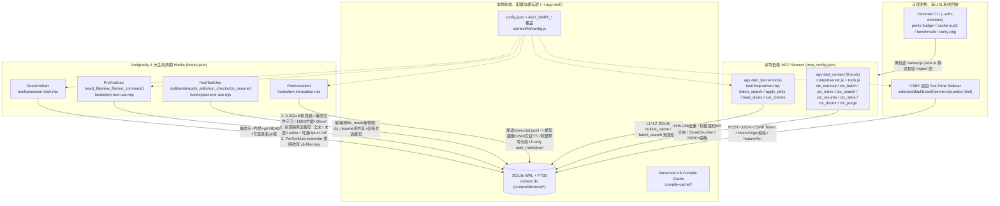

# `agy-dart` — AI 审阅技术简报（AI Review Brief）

> **本文档用途**：面向代码审阅 AI / 架构审计 AI / 安全审查 AI 的高密度项目总览与审阅路线图。对应代码与测试基线提交：`2da9f12`（正式发布标签 `v1.2.0`）。代码行数、模块映射与测试数量由 `scripts/gen-review-brief.mjs` 自动同步并受 `--check` 漂移守卫保护。

<!-- AUTO:META:START -->
> **同步快照（由 `scripts/gen-review-brief.mjs` 自动维护）**：版本 `v1.2.0` · 核心追踪文件 36 个（合计 36,222 行） · 测试套件 16 个 / 117 个用例 · 可运行 `node scripts/gen-review-brief.mjs --check` 检验零漂移。
<!-- AUTO:META:END -->

---

## 1. 项目一句话定位、硬不变量与威胁模型

**`agy-dart`** 是面向 **Google Antigravity**（Desktop 2.0 / IDE / CLI）的原生一体化插件，将 **极速批处理加速引擎 (`agy-dart_fast`)**、**沙盒过滤与 SQLite FTS5 上下文护栏 (`agy-dart_context`)**、**4 个生命周期 Hooks**、**服务端 Prompt Cache / KV-Cache 诊断与回放体系** 以及 **Aux Pane 实时 Sidecar 仪表盘** 融合成单一零依赖插件。

### 1.1 审阅时必须核验的 8 条硬不变量

| # | 硬不变量 | 验证位置 |
| :-: | :--- | :--- |
| 1 | **零运行期 npm 依赖**：仅使用 Node.js `>= 22` 内置模块（`node:sqlite`、`node:zlib`、`node:crypto`、`node:module` 等），`package.json` 无 `dependencies` | `package.json` |
| 2 | **严格 MIT 净室合规**：严禁引入 ELv2 / BUSL-1.1 / AGPL-3.0 / Apache-2.0 源码，所有借鉴模式须为净室实现并登记于声明文件 | `THIRD_PARTY_NOTICES.md`、`LICENSE` |
| 3 | **MCP 单次响应严格 `<= 8.8 KB` UTF-8**：基于实测 Antigravity MCP 工具返回约 `10 KB` 即触发落盘 `output.txt` 造成二次读取，扣除 JSON-RPC 封装与转义开销后留取 `8.8 KB`（`8,800` / `8,100` B）安全内联上限；截断不得劈裂 UTF-8 多字节（尤其 CJK/Emoji） | `fast/mcp-server.mjs`、`context/lib/tools.js`、`hooks/filter-rules.mjs` |
| 4 | **JSON-RPC stdio 零污染（0 字节 stderr）**：双 MCP 服务与 4 个生命周期钩子（含 V8 编译缓存激活、SQLite `ExperimentalWarning` 拦截及异常 fail-open）在 Node 22.x / 24.x 下均不得向 `stdout`/`stderr` 输出任何杂音 | `fast/mcp-server.mjs`、`context/server.js`、`hooks/compile-cache.mjs` |
| 5 | **Turn-0 前缀确定性与预算封顶**：双 MCP `tools/list` 按键名与工具名规范排序（`canonical = true`）、两次握手 SHA-256 一致；常驻 Turn-0 总估算 `<= 4,000` tokens（含跨语种校准 `±15%` 误差上界） | `scripts/prefix-budget.mjs`、`scripts/cache-audit.mjs`、`context/lib/stable-json.js` |
| 6 | **中段 Hook 零前缀污染**：`PreInvocation` 告警必须输出 `systemMessage: ""` + `metadata.user_markdown`，严禁向模型注入动态文本破坏服务端 KV-Cache | `hooks/pre-invocation.mjs` |
| 7 | **钩子严格 Fail-Open 与 0-SQLite 快路径**：任何 Hook 遇到 DB 锁/权限/异常都必须放行；`read_file` 对 `SKILL.md`/`AGENTS.md`/附件/二进制及未受管工具不得打开或创建 SQLite DB，并受 p50/p95 延迟预算约束 | `hooks/pre-tool-use.mjs`、`hooks/post-tool-use.mjs`、`hooks/session-start.mjs` |
| 8 | **端到端安全边界**：`ctx_index(url)` 强制 SSRF 逐跳 DNS（含 IPv4 映射 IPv6）与 IP Pinning；CLI 过滤严禁放行未授权 Shell 注入或 cmd/PS 跨 Shell 语义漂移元字符；`.agy-dart/filters.json` 拒收指数/分组多项式 ReDoS 正则；Sidecar 强制 `Host`/`Origin`/`Sec-Fetch-Site`（含 `same-site`）防 DNS Rebinding 与跨端口 CSRF、全部独立 HTTP `/api/*`（GET/POST）强制随机 `X-Agy-Dart-Token`、`SidecarApp` 模式全部 `/api/*` 路由仅限 `POST`（强制 `X-Sidecar-Token`）、写接口与 `/api/search` 仅 `POST` + `application/json` + `64 KB` 请求体上限，前端防 XSS | `context/lib/security.js`、`hooks/filter-rules.mjs`、`sidecars/dashboard/{server.mjs,index.html}` |

### 1.2 威胁模型（Threat Model）

| 主体 / 输入来源 | 信任级别 | 假设威胁与防护策略 |
| :--- | :---: | :--- |
| **本地用户与 `~/.agy-dart/config.json`** | 可信 | 拥有本机权限与配置控制权；配置解析仍采用 fail-open，畸形 JSON 不会导致 Hook 崩溃 |
| **LLM 模型生成的工具参数** | 半可信（可能幻觉/受间接提示注入） | `ctx_index(url)` 强制 SSRF 与私网/回环/元数据拦截；`run_command` 仅对白名单单条安全命令透明改写，拒绝管道/重定向/子 Shell/cmd&PS 元字符；`diffRead` 默认关闭并严格绑定直接对话 ID 与新鲜度窗口 |
| **工作区仓库内的 `.agy-dart/filters.json`** | 不可信（可能来自第三方恶意仓库） | 所有自定义正则先过零依赖 `isSafeRegex` ReDoS 检测（拒收嵌套量词、分组/非相邻可重叠循环、歧义分支、反向引用与超大重复界），非法规则静默降级跳过 |
| **本机任意浏览器标签页 / 恶意网页** | 不可信 | 攻击者可能通过 ``、同机跨端口请求（`Sec-Fetch-Site: same-site`）、CORS 简单 POST 或 DNS Rebinding 访问 Sidecar。防护：写操作与 `/api/search` 禁止 GET、校验 `Host` 仅限 loopback、拦截 `cross-site` 与 `/api/*` 上的 `same-site`、全部独立 HTTP `/api/*` 请求强制随机 `X-Agy-Dart-Token`、写接口强制 `Content-Type: application/json` 与 `64 KB` 请求体封顶；SidecarApp 模式对全部 `/api/*` 路由（含只读与写接口）均强制仅限 POST（禁止 GET），以确保 `sidecar_sdk` 强制校验 `X-Sidecar-Token` |
| **远端 HTTP(S) 响应与本地大文件/日志** | 不可信（可能含密钥、恶意重定向或超长多字节载荷） | `fetchUrlText` 限制协议/重定向次数/总字节与超时并做 DNS Pinning；入库与回传前执行 `redactSecrets`；输出经 UTF-8 安全截断不产生 `\uFFFD` 或孤立代理项 |

### 1.3 硬不变量 → 测试用例对照表

| 不变量 | 关键覆盖测试文件与用例名称 |
| :-: | :--- |
| #1 零运行期 npm 依赖 | `package.json`（无 `dependencies`）+ `tests/v1.2-hardening.test.mjs` (`P1-Hardening 3: Static import-graph verification...`) |
| #2 MIT 净室合规 | `THIRD_PARTY_NOTICES.md`、`LICENSE`（人工与发版审阅清单） |
| #3 `<= 8.8 KB` UTF-8 无损截断 | `tests/v1.2-property-fuzz.test.mjs` (`Property 1: UTF-8 truncation helpers...`), `tests/v1.2-cli-crusher.test.mjs`, `tests/v1.1-roi-optimizations.test.mjs` (`Opt 5`, `Hardening regressions`) |
| #4 stdio 零污染（0B stderr） | `tests/v1.2-hardening.test.mjs` (`P1-Hardening 5: Exact 0-byte stderr...`), `tests/v1.2-quickfixes.test.mjs` (`Fix 2`), `tests/v1.2-persist-prefix.test.mjs` (`P1-8B`) |
| #5 Turn-0 确定性与预算校准 | `tests/v1.2-hardening.test.mjs` (`P1-Hardening 7: Token estimator empirical calibration...`), `tests/v1.2-cache-audit.test.mjs` (`1.`, `2.`), `tests/v1.2-persist-prefix.test.mjs` (`P1-5C`), `tests/v1.2-quickfixes.test.mjs` (`Fix 4`) |
| #6 中段 Hook 零前缀污染 | `tests/v1.2-ttl-handoff.test.mjs` (`P1-7.4`), `tests/v1.1-features.test.mjs` (`P0 PreInvocation hook...`), `tests/v1.2-cache-model.test.mjs` (`P0-2.6`) |
| #7 Fail-Open、0-SQLite 与延迟预算 | `tests/v1.2-hardening.test.mjs` (`P1-Hardening 6: Hook latency budgets...`), `tests/integration.test.mjs`, `tests/v1.1-tianshu-cache.test.mjs` |
| #8 SSRF / Shell / ReDoS / Sidecar CSRF & XSS | `tests/v1.2-hardening.test.mjs` (`P0-Hardening 1: Sidecar CSRF...`), `tests/v1.2-property-fuzz.test.mjs` (`Property 2`, `Property 3`, `Property 5`), `tests/v1.1-roi-optimizations.test.mjs` (`Opt 2`, `Hardening regressions`), `tests/v1.2-context-breakdown.test.mjs` (`P2-9.4`) |

---

## 2. 架构与控制流总览



---

## 3. 代码地图（按子系统与自动同步精确规模）

<!-- AUTO:CODE_MAP:START -->
### 3.1 核心库 (`context/lib/`)

| 文件 | 行数 | 核心职责与关键导出 |
| :--- | ---: | :--- |
| `context/lib/store.js` | 200 | `ContextModeStore` 门面类：统一导出与原型聚合（下拆 `context/lib/store/` 5 个职责子模块） |
| `context/lib/store/schema.js` | 323 | SQLite WAL + FTS5 DDL、幂等列迁移（`content_hash`/`full_read_ts`/`full_read_seq`）、常量与路径解析 |
| `context/lib/store/fts.js` | 626 | 标题感知 Markdown 分块、SHA-256 去重索引、Porter BM25 + Trigram RRF 检索与事件流 |
| `context/lib/store/reads.js` | 610 | 会话未变更读去重（`file_reads`）、gzip 文本快照（`file_snapshots`）、会话轮次序与 Ghost Registry |
| `context/lib/store/checkpoints.js` | 402 | 结构化会话恢复卡（`session_checkpoints`）、持久化符号大纲（`outline_cache`）与 `repo_cache` |
| `context/lib/store/settings-maintenance.js` | 1,043 | `meta` 配置、阈值/豁免管理、`getStats`、`getFeatureRoi` 遥测 ROI 量化、TTL 清理与 `VACUUM` |
| `context/lib/config.js` | 303 | 统一配置加载器（`~/.agy-dart/config.json` + `AGY_DART_*` 环境变量覆盖 + 生效来源追踪） |
| `context/lib/cache/profiles.js` | 303 | `MODEL_CACHE_PROFILES`（含 Gemini 4/Neon/Carbon/Argon/Hydrogen、Claude 4 系列）、`resolveModelProfile`、`computeCacheWarmth` 与写溢价成本数学 |
| `context/lib/cache-analyzer.js` | 2,247 | Transcript KV-Cache 诊断引擎：多厂商 Token 提取（防重计）、实证 TTL 校准、7 桶 `contextComposition`、`subagentBreakdown`、死循环 `loopWatch`、6 类 Bust 归因 |
| `context/lib/cache-simulator.js` | 1,190 | 离线策略回放引擎（devtools）：对比 7 套策略（`observed`、`ttl-5m`、`ttl-1h`、`cold-boundary-compact`、`cutoff-strict/balanced/relaxed`） |
| `context/lib/repo-skeleton.js` | 1,060 | `git HEAD` 缓存的核心依赖枢纽扫描（JS/TS + JSONC `tsconfig` `paths`、Python、Rust、Go `go.mod`、Vue/Svelte、Dart、Java） |
| `context/lib/json-crusher.js` | 876 | 零依赖可逆 JSON/JSONL 结构化粉碎器：提取 Schema/空值统计 + 首尾样本 + 异常项，附带 FTS5 `sourceId` |
| `context/lib/tools.js` | 949 | `agy-dart_context` 8 个 MCP 工具实现；`dedup: true`、`smartCrushJson`、`featureRoi`、生效配置诊断与 `<= 8.8 KB` UTF-8 封顶 |
| `context/lib/security.js` | 615 | `validateFetchTarget`（SSRF 逐跳 DNS + IPv4/IPv6 + IP Pinning）、`redactSecrets`、`detectSensitiveFile` |
| `context/lib/handoff.js` | 574 | 缓存友好交接摘要生成器：`buildHandoffBrief`（分支 + `git diff --stat`、`sessionCheckpoint`、FTS5 句柄、脱敏与 UTF-8 封顶） |
| `context/lib/text-diff.js` | 442 | 零依赖行级 Unified Diff 引擎：首尾裁剪 + 有界 Myers + 线性降级保护 + 1-based `startLine` 偏移 |
| `context/lib/executor.js` | 341 | 本地沙盒脚本执行器（JS/Node/Python/Shell/PowerShell/CMD，带输出封顶与超时清理） |
| `context/lib/stable-json.js` | 55 | `stableSortObject`、`stableStringify`、`sha256Hex`（保证 MCP Schema 与指纹 100% 字节确定性） |

### 3.2 生命周期钩子 (`hooks/`)

| 文件 | 行数 | 核心职责与关键导出 |
| :--- | ---: | :--- |
| `hooks/filter-rules.mjs` | 2,361 | CLI 降噪规则库：安全拆解单层 `cd [/d] <path> && <cmd>` + `2>&1`、拦截 cmd/PS 危险语法（`%`/`!`/`{}`/`@`/非 git `^`）、11 类内置规则、`.agy-dart/filters.json` ReDoS 防护与大 JSON 粉碎 |
| `hooks/pre-tool-use.mjs` | 1,293 | 统一 `PreToolUse` 网关：0-SQLite 快路径 → 可选敏感文件守卫 → 16 KB/410 行大文件拦截 + Ghost → 三态读缓存（`diffRead` 默认关闭、按直接对话 ID 隔离且受轮次/时间新鲜度约束）→ `run_command` 透明 `overwrite` |
| `hooks/pre-invocation.mjs` | 410 | 零前缀污染 `PreInvocation` 守卫：尾读 `transcript.jsonl`，输出水位/热缓存延迟/TTL 预警/多模态悬崖/死循环告警（全部 `systemMessage: ""`），且在 `cacheWatch=false`/暂停下仍维持 `diffRead` 轮次递增 |
| `hooks/post-tool-use.mjs` | 404 | 编辑触发单文件 `file_reads` 失效（保快照）并记录 `modifiedFiles`；`ctx_resume` 同时清共享与直接对话快照；写入测试/构建结论到 `sessionCheckpoint` |
| `hooks/cli-filter.mjs` | 455 | `PreToolUse.overwrite` 执行代理：Windows `cmd.exe`/`powershell.exe` 精确透传退出码、密钥脱敏、原输出入 FTS5、降噪并死守 `<= 8.8 KB` |
| `hooks/session-start.mjs` | 314 | 前缀稳定启动钩子：支持 `stablePrefixOnly` 与子 Agent 自动省略易变 Git 尾段（并在子进程隔离禁用 Git） |
| `hooks/compile-cache.mjs` | 206 | 版本化 V8 编译缓存管理（保留最近 3 个版本）与跨 Node 22/24 的 `suppressSqliteExperimentalWarning()` 零 stderr 护栏 |

### 3.3 双 MCP 引擎、Sidecar 面板与审计脚本

| 文件 | 行数 | 核心职责与关键导出 |
| :--- | ---: | :--- |
| `fast/mcp-server.mjs` | 4,698 | `agy-dart_fast` 4 工具批处理引擎：V8 编译缓存、`read_slices` L1+L2 SQLite `outline_cache` 与 4 MB 切片缓存、`batch_search` 工作区指纹缓存 |
| `fast/benchmark.mjs` | 1,555 | 离线轨迹基准 CLI（devtools）：`analyze`、`compare`、`cache`、`cache simulate` |
| `fast/session-start.mjs` | 905 | 上游工作区结构与 Git 状态快照生成器（由 `hooks/session-start.mjs` 封装调用，已禁自动更新） |
| `context/server.js` | 311 | `agy-dart_context` MCP stdio 服务端：先激活 V8 编译缓存与 SQLite 告警静默再动态加载库模块；导出冻结规范排序 `TOOL_DEFINITIONS` |
| `scripts/cache-audit.mjs` | 2,746 | 全域环境 Prompt Cache 体检 `npm run cache:audit`（devtools）：规则/技能 CJK 估 token、双次握手探测 MCP 确定性、静态分析中段 Hook |
| `scripts/install.mjs` | 805 | 跨平台安装/卸载/模式切换/`doctor` 健康自检：拆分 `RUNTIME_FILES`（默认）与 `DEVTOOLS_FILES`（`--with-devtools`），`doctor` 输出生效配置 |
| `scripts/verify-package-graph.mjs` | 1,139 | 静态 Import 图打包校验器（devtools）：线性 JS 词法解析器提取含/无分号（ASI）、多行、注释穿插与带属性动态导入的 ESM/CJS 依赖，证明无漏打模块且 devtools 零泄漏 |
| `scripts/prefix-budget.mjs` | 920 | Turn-0 前缀预算、双 MCP 指纹与 `--calibrate` 跨语种 Token 估算误差校准审计（devtools，读取统一 `config.json`，超预算/非规范时非零退出码卡口 CI） |
| `scripts/gen-review-brief.mjs` | 313 | `AI_REVIEW_BRIEF.md` 代码行数/测试基线自动生成与 `--check` 漂移守卫（devtools） |
| `sidecars/dashboard/server.mjs` | 1,276 | Sidecar HTTP / SidecarApp 服务：严格 `Host`/同源 `Origin`/`Sec-Fetch-Site` 白名单（拦截 `cross-site`、`same-site` 及伪造头）、`X-Frame-Options: DENY`、独立 HTTP 全部 `/api/*` 强制随机 `X-Agy-Dart-Token`、SidecarApp 模式全部 `/api/*` 仅限 POST（强制 `X-Sidecar-Token`）、写接口与 `/api/search` 仅 POST + `application/json` + 64 KB 请求体上限与 `featureRoi` |
| `sidecars/dashboard/index.html` | 3,952 | 实时仪表盘前端：自动注入并携带 CSRF Token、全部 `/api/*` 调用统一 POST JSON、XSS 转义加固、1s 本地 TTL 进度条、Handoff 抽屉与上下文构成条 |
<!-- AUTO:CODE_MAP:END -->

---

## 4. SQLite 数据库表结构（`~/.agy-dart/context.db`）

WAL 模式 + `busy_timeout = 5000` + `synchronous = NORMAL` + `_withBusyRetry` 重试；`meta.schema_version` 维持 `'3'` 并通过幂等 `CREATE TABLE IF NOT EXISTS` / `ALTER TABLE` 保证对旧库无损升级：

- `meta`：配置、阈值覆盖、告警去重时间戳、维护时间戳与每对话单调轮次序（`conv_turn_seq:<convId>`）
- `sources` + FTS5 `chunks` (Porter) & `chunks_tri` (Trigram)：索引内容与 `content_hash`（SHA-256 去重）
- `events`：工具执行、拦截、CLI 过滤与读去重遥测流水（支持 `getFeatureRoi` 按功能量化 ROI）
- `file_reads`：按直接对话 ID 隔离的未变更文件读取记录（压缩事件边界失效，2-strike `bypass_armed`）
- `file_snapshots`：按直接对话 ID 隔离的 gzip 压缩文本快照（`<= 256 KB`/文件、64 条/会话 LRU，记录 `full_read_ts` & `full_read_seq` 约束 Diff 新鲜度）
- `outline_cache`：持久化符号大纲缓存（`<= 512` 条 LRU，`(file_path, mtime_ms, file_size)` 校验）
- `repo_cache`：按 `(workspace_dir, head_sha, kind)` 缓存核心导入枢纽
- `ghost_interceptions`：大文件拦截后二次分页召回效率追踪（Ghost Registry）
- `session_checkpoints`：结构化会话恢复卡（最近修改文件、最新测试与构建结论）

---

## 5. 统一配置文件（`~/.agy-dart/config.json`）与环境变量覆盖清单

所有开关统一收敛于 `~/.agy-dart/config.json`（路径可用 `AGY_DART_CONFIG_PATH` 覆写），解析顺序为 **`AGY_DART_*` 环境变量 > `config.json` > 内置默认值**；运行 `npm run doctor` 或 `ctx_doctor` 即可输出当前生效配置及覆盖来源。

| `config.json` 键 | 对应环境变量覆盖 | 默认值 | 作用 |
| :--- | :--- | :---: | :--- |
| `dbPath` | `AGY_DART_DB_PATH` | `~/.agy-dart/context.db` | 自定义 SQLite 数据库路径（测试隔离核心开关） |
| `compileCache` / `compileCacheDir` | `AGY_DART_DISABLE_COMPILE_CACHE` / `_DIR` | `true` / `null` | V8 版本化编译缓存开关与目录 |
| `stablePrefixOnly` / `subagentIncludeGit` | `AGY_DART_STABLE_PREFIX_ONLY` / `SUBAGENT_INCLUDE_GIT` | `false` / `false` | 省略易变 Git 尾段实现跨会话/子 Agent 共享前缀 |
| `repoHubs` | `AGY_DART_DISABLE_REPO_HUBS` | `true` | `SessionStart` 依赖枢纽扫描 |
| `readHook` / `readDedup` | `AGY_DART_DISABLE_READ_HOOK` / `_READ_DEDUP` | `true` / `true` | 读守卫与未变重复读 2-strike 去重 |
| `diffRead` | `AGY_DART_ENABLE_DIFF_READ` / `AGY_DART_DISABLE_DIFF_READ` | **`false`** | 修改后增量 Unified Diff 读缓存（**默认关闭**，需显式开启；`DISABLE=1` 优先级最高） |
| `diffReadMaxTurns` / `diffReadMaxAgeMs` | `AGY_DART_DIFF_READ_MAX_TURNS` / `_MAX_AGE_MS` | `12` / `900000` | Diff 基线新鲜度上界（超过则自动回退全文放行，含 `PreInvocation` 轮次推进） |
| `maxReadBytes` / `maxLineRange` / `maxOutputBytes` | `CONTEXT_MODE_MAX_READ_BYTES` / `_LINE_RANGE` / `_OUTPUT_BYTES` | `null` / `null` / `8100` | 读截断字节阈值、单次最大行窗与沙盒预览上限覆写 |
| `cliFilter` | `AGY_DART_DISABLE_CLI_FILTER` | `true` | 透明 CLI 输出降噪 |
| `outlineDb` / `searchCacheTtlMs` | `AGY_DART_DISABLE_OUTLINE_DB` / `SEARCH_CACHE_TTL_MS` | `true` / `15000` | `read_slices` L2 持久化与 `batch_search` 短效缓存 |
| `cacheWatch` | `AGY_DART_DISABLE_CACHE_WATCH` | `true` | `PreInvocation` KV-Cache 监控 |
| `cacheTtlSec` / `windowTokens` / `warnTokens` / `criticalTokens` | `AGY_DART_CACHE_TTL_SEC` / `WINDOW_` / `WARN_` / `CRITICAL_TOKENS` | `null`（模型自适应） | 手动覆写模型 TTL 与水位阈值 |
| `secretRedaction` | `AGY_DART_DISABLE_SECRET_REDACTION` / `_SECRET_REDACTION` | `true` | 落库/回传前轻量密钥脱敏 |
| `sensitiveFileGuard` | `AGY_DART_SENSITIVE_FILE_GUARD` | `"off"` | 可选敏感文件读取守卫（`off` / `warn` / `deny`） |
| `allowPrivateUrls` | `AGY_DART_ALLOW_PRIVATE_URLS` | `false` | 放行 `ctx_index(url)` 访问私网/回环地址 |

---

## 6. 给审阅 AI 的重点攻防检查清单（High-Risk Review Focus）

1. **Sidecar 鉴权、CSRF 与 DNS Rebinding**：审查 `sidecars/dashboard/server.mjs` 与 `index.html`：确认全部独立 HTTP `/api/*` 端点（含 GET 与 POST）均强制校验随机 `X-Agy-Dart-Token`（`timingSafeEqual`）、拦截 `/api/*` 上的 `Sec-Fetch-Site: cross-site` 与 `same-site`、所有写端点与 `/api/search` 仅限 `POST` + `application/json`、全站校验 `Host` 仅限 loopback 且 `Origin` 同端口防跨端口与 DNS Rebinding、`64 KB` 请求体硬上限（含 `Content-Length` 前置拒绝与 `Connection: close`）、自定义扩展名入库净化与前端全量 `escapeHtml`（含 `scopeLabel`），并确认 `SidecarApp` 模式下全部 `/api/*` 路由（含只读与写接口）均注册为仅限 `POST`（禁止 `GET`）、`index.html` 对全部 `/api/*` 调用统一发 `POST`，以确保 `sidecar_sdk` 强制执行 `X-Sidecar-Token` 鉴权。
2. **三态文件读缓存基线归属与新鲜度**：审查 `hooks/pre-tool-use.mjs` + `hooks/post-tool-use.mjs` + `hooks/pre-invocation.mjs` + `context/lib/store/reads.js`：验证 `diffRead` 默认关闭、按直接 `conversationId` 隔离（子 Agent/fork 永不串读父快照或污染父 `file_reads`）、`bumpConversationTurnSeq` 多进程 `BEGIN IMMEDIATE` 原子递增、非读轮次由 `PreInvocation` 同步推进（即使 `cacheWatch: false` 时仍正常推进 `conv_turn_seq`）、`ctx_resume` 同时清空共享与直接对话快照，以及 Myers Diff 往返正确性（`apply(diff(a,b), a) === b`）。
3. **Shell 注入、跨 Shell 语义漂移与退出码一致性**：审查 `hooks/filter-rules.mjs` 的 `hasUnsafeShellSyntax`（拦截管道/重定向/子 Shell/NUL/`%`/`!`/`{}`/`@`/非 git `^`）与 `unwrapSafeCompoundCommand`（含单/双引号与无引号 `cd` 路径全量拒绝 `!`/`^`/`{}`/`@`/`\0`）、`isSafeRegex` 指数与分组/非相邻多项式 ReDoS 防护，以及 `hooks/cli-filter.mjs` 在 `cmd.exe` vs `powershell.exe` 下的退出码透传。
4. **Hook 冷/热启动延迟预算与零 stderr 约束**：审查 `hooks/pre-tool-use.mjs` 0-SQLite 快路径与 SQLite 读缓存路径的 p50/p95 延迟断言，以及 `hooks/compile-cache.mjs` 顶层立即挂载 `suppressSqliteExperimentalWarning()` 解决静态 ESM import 提升顺序问题，在 Node 22.x/24.x CI 矩阵下保证 0 字节 `stderr`。
5. **Token 统计口径、成本数学与估算校准**：审查 `context/lib/cache-analyzer.js` 的 `extractStepTokenUsage`（防重复累加）、`context/lib/cache/profiles.js` 与 `cache-simulator.js` 的写溢价和 Cutoff 单调性，以及 `scripts/prefix-budget.mjs`（读取统一 `config.json` 的 `stablePrefixOnly`、超预算/上界或非规范 `tools/list` 时以退出码 `1` 卡口 CI，并支持 `--calibrate` / `--auto-transcript` 真实 `usageMetadata` 回归校准）。
6. **缓存失效、SSRF/ReDoS 与打包图完整性**：审查 `fast/mcp-server.mjs` 的 L1/L2 失效、`context/lib/security.js` 与 `context/lib/tools.js` 的 IPv4 映射 IPv6 + 端到端两跳重定向 TTL=0 DNS Rebinding IP Pinning、`hooks/filter-rules.mjs` 的 ReDoS 校验，以及 `scripts/verify-package-graph.mjs` 的静态 Import 图闭环检验（含 ASI 无分号/多行 ESM 导入导出，验证 `RUNTIME_FILES` vs `DEVTOOLS_FILES`）。

---

## 7. 一键验证命令与当前实测基线

在 `e:\work\agy-dart` 下运行：

```bash
# 1. 全量 16 个测试套件（integration + 3 套 v1.1 + 12 套 v1.2 含安全加固、属性/模糊与深度审计回归测试）
npm test
# 预期基线：117/117 PASS, 0 fail

# 2. 静态 Import 图打包完整性与 runtime/devtools 隔离校验
npm run verify:pkg
# 预期基线：PASS（0 missing runtime modules, 0 devtools leaked）

# 3. Turn-0 前缀预算、双 MCP 规范性与跨语种 Token 估算校准
npm run prefix:budget
node scripts/prefix-budget.mjs --stable-only --json
node scripts/prefix-budget.mjs --calibrate
node scripts/prefix-budget.mjs --calibrate --auto-transcript
# 预期基线：~2,960 est. tokens（+15% 上界 <= 4,000）, canonical=true, MAPE ~5.3%

# 4. 全域环境 Prompt Cache 体检 & 离线 7 策略回放
npm run cache:audit -- --workspace . --no-live
npm run cache:simulate

# 5. 审阅简报行数与测试基线零漂移检验
npm run brief:check

# 6. 健康检查（含生效配置与覆盖来源报告）
npm run doctor
```

---

## 8. 已知平台边界与刻意非目标（供审阅对齐，避免误报）

- **不拦截上游 LLM HTTP 请求体**：Antigravity 插件仅拥有 Hooks / MCP / Sidecar 边界，无法改写上游 API JSON body；因此服务端缓存优化聚焦于 **Turn-0 前缀确定性、零污染中段 Hook、输入降噪/去重/可选 Diff、离线归因与策略回放**。
- **不引入向量数据库 / 本地 Embedding 模型**：坚持零 npm 依赖与毫秒级启动，全文检索使用 `node:sqlite` 内置 FTS5（Porter BM25 + Trigram RRF）而非 ONNX/向量依赖。
- **安装默认精简运行时**：`scripts/install.mjs install` 默认仅拷贝 `RUNTIME_FILES`；需要离线审计、压测或策略回放 CLI 时传入 `--with-devtools` 同步安装 `DEVTOOLS_FILES`。
